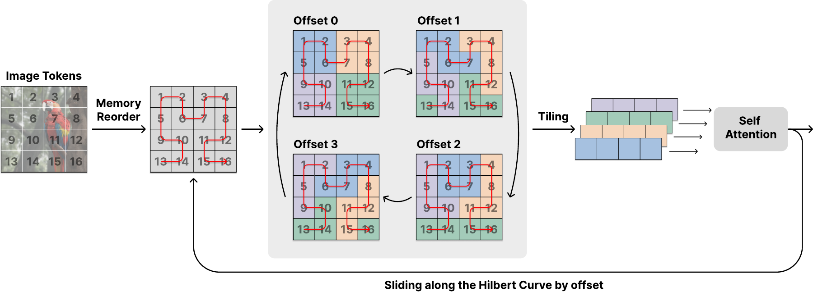

<h1 align="center">HilbertA</h1>

<p align="center">
  <strong>Hilbert-Curve–Aligned Sparse Attention for 2D Structured Data</strong><br>
  Shaoyi Zheng · Wenbo Lu · Yuxuan Xia · Shenji Wan<br>
  <em>ICML 2026</em>
</p>

<p align="center">
  <a href="https://wenboluu.github.io/hilberta/"></a>
  <a href="https://proceedings.mlr.press/v306/zheng26m.html"></a>
  <a href="https://arxiv.org/abs/2509.26538"></a>
  <a href="https://huggingface.co/black-forest-labs/FLUX.1-dev"></a>
  <a href="#citation"></a>
</p>

<p align="center">
  <a href="#install">Quick start</a> · <a href="docs/REPRODUCE.md">Reproduction guide</a> · <a href="AGENTS.md">Agent guide</a>
</p>

[](docs/assets/hilberta-pipeline.pdf)

HilbertA combines spatially local token ordering with contiguous sparse attention. This repository releases the **FLUX.1-dev** implementation, with reciprocal block bridges added to the paper's ordering, tiling, and sliding pipeline.

**Default:** 4 tiles, K1, no shared image region. Use 16 tiles / K3 for more speed. Both preserve global text attention. Inference uses the **paired Triton kernel with persistent layout**; LoRA training uses **FlexAttention (block size 64)**.

## Install

Linux · Python 3.10 · NVIDIA GPU with BF16 support · CUDA 12.6-compatible driver.

```bash
git clone https://github.com/wenboluu/hilberta.git
cd hilberta
python3.10 -m venv .venv
source .venv/bin/activate
python -m pip install --upgrade pip
python -m pip install torch==2.9.0 torchvision==0.24.0 --index-url https://download.pytorch.org/whl/cu126
python -m pip install -c requirements-cu126.txt -e '.[test,eval]'
```

Accept the [FLUX.1-dev terms](https://huggingface.co/black-forest-labs/FLUX.1-dev), then authenticate with `hf auth login`.

## Generate

**Trained HilbertA LoRA weights are not yet published.** Use your own compatible adapter, or run an explicitly untrained smoke test:

```bash
python -m hilberta.generate --adapter path/to/adapter.pt \
  --prompts configs/prompts.example.jsonl --output outputs/hilberta

# Without an adapter: smoke test only, not reported image quality.
python -m hilberta.generate --allow-untrained \
  --prompts configs/prompts.example.jsonl --output outputs/smoke
```

Use `--method full` for the original FLUX baseline. Add `--tiles 16 --k 3` or `--resolution 2048` with the corresponding trained adapter. Output directories must be new.

## Training and results

See the [reproduction guide](docs/REPRODUCE.md) for teacher caching, DDP LoRA training, resume, evaluation, and kernel benchmarks. [Configurations](configs/) cover 1024/2048 × 4-tile K1/16-tile K3. For coding agents, [AGENTS.md](AGENTS.md) maps the implementation and required checks.

Full quality and speed comparisons are on the [project page](https://wenboluu.github.io/hilberta/) and in the [results reference](docs/RESULTS.md). [JSON](results/image_results.json) and [CSV](results/efficiency_all_rows.csv) retain the measurements. Exact evaluation prompts and trained adapters are not bundled; production parity of the portable training/evaluation runners remains to be verified. 4096 results cover performance only.

## Citation

```bibtex
@inproceedings{pmlr-v306-zheng26m,
  title     = {{HilbertA}: {Hilbert-Curve–Aligned} Sparse Attention for {2D} Structured Data},
  author    = {Zheng, Shaoyi and Lu, Wenbo and Xia, Yuxuan and Wan, Shenji},
  booktitle = {Proceedings of the 43rd International Conference on Machine Learning},
  series    = {Proceedings of Machine Learning Research},
  volume    = {306},
  pages     = {163439--163462},
  year      = {2026},
  publisher = {PMLR},
  url       = {https://proceedings.mlr.press/v306/zheng26m.html}
}
```

## License

[MIT](LICENSE) for this code. Model, dataset, dependency, and paper-figure rights remain with their respective authors; see [third-party notices](docs/THIRD_PARTY.md).
